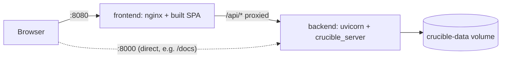

# Deployment

The easiest way to run Crucible is with Docker Compose — it builds the
backend and frontend images and wires them together, with no local Python
or Node install required.

```bash
docker compose up --build
```

- **Frontend:** [http://localhost:8080](http://localhost:8080)
- **Backend API:** [http://localhost:8000](http://localhost:8000) (interactive docs at `/docs`)

Stop everything with `Ctrl+C`, or `docker compose down`. Add `-v` to also
delete the named volume holding workflows/run history
(`docker compose down -v`).

## Trying the bundled examples

The repository includes three small synthetic CSV datasets and three
workflows: café sales cleanup, a category sales summary, and stock cleanup.
After starting Compose, load editable copies into the workspace:

```bash
docker compose exec backend python /examples/load.py
```

Refresh the GUI workflow list and open an `example_` workflow. Samples are
mounted read-only at `/examples`; workflow copies and exports live in the
persistent workspace at `/data`. Existing workflow names are skipped when
loading again, preserving edits. See the
[playground walkthrough](https://github.com/Nietaktowny/Crucible/tree/main/examples)
for the expected results, exercises, export retrieval and local setup.

## Using local files in the Docker test deployment

**Workflow file paths are resolved by the backend inside its container.**
The default Compose deployment mounts the workspace volume at `/data` and
the repository's bundled samples at `/examples`; other files on your computer
are not exposed. Entering a
host path in the GUI does not transfer the file, and Crucible currently has
no browser file-upload endpoint. The same constraint applies when inspecting
Excel sheet names, previewing data, running workflows and writing exports.
This is a file-sharing requirement of the test deployment: prepare the
backend's inputs and outputs before testing workflows.

For local testing, share dedicated input and output folders using
[Docker bind mounts](https://docs.docker.com/engine/storage/bind-mounts/).
From the repository root, create the folders:

```bash
mkdir -p data/input data/output
```

Create `docker-compose.override.yml` beside `docker-compose.yml` (or add
these mounts to your existing override):

```yaml
services:
  backend:
    volumes:
      - type: bind
        source: ./data/input
        target: /files/input
        read_only: true
      - type: bind
        source: ./data/output
        target: /files/output
```

Compose automatically merges this override with the base configuration,
keeping the workspace volume at `/data`. Start or recreate the services:

```bash
docker compose up --build -d
```

Copy your test files into `data/input`, then enter the **container path**
in workflow steps:

| File or folder on the Docker host | Path in a workflow |
| --- | --- |
| `./data/input/sales.csv` | `/files/input/sales.csv` |
| `./data/input/sales.xlsx` | `/files/input/sales.xlsx` |
| `./data/input/monthly/` | `/files/input/monthly` |
| `./data/output/result.csv` | `/files/output/result.csv` |

Input is read-only; write steps must use `/files/output` and any required
subdirectories must already exist. Host permissions must allow the backend
to read inputs and write outputs. Use absolute container paths: relative
paths resolve from `/app` in the current image, not from the host checkout
or `/data`.

After placing `sales.csv` in the input folder, check that the running
backend can read it:

```bash
docker compose exec backend python -c "from pathlib import Path; print(Path('/files/input/sales.csv').open('rb').read(100))"
```

Then run a workflow with `read_csv` at `/files/input/sales.csv` and
`write_csv` at `/files/output/result.csv`. Confirm the preview contains the
expected rows and `data/output/result.csv` appears on the host. A healthy
container alone does not verify that the deployment can access test data.

Files added to the mounted input folder become available without rebuilding
the image. Files outside the shared folders remain inaccessible unless you
copy them into a shared folder or add another mount and recreate the
backend. Mount only the folders needed for the test. Changing the workspace
volume does not expose unrelated host paths.

For a remote deployment, the folders must exist on the **Docker daemon's
host**. Opening the GUI from another computer does not give the backend
access to that computer's files; transfer them to the shared server folder
first. Docker Desktop may also require permission to share the chosen host
folder. For a one-off test without a bind mount, you can copy a file into
the running backend with `docker compose cp ./sales.csv backend:/data/sales.csv`
and use `/data/sales.csv` in the workflow. That copy persists in the workspace
volume until it is removed (including by `docker compose down -v`).

## How it's wired together



- **`backend`** — built from the root `Dockerfile`'s `runtime` stage:
  installs the `crucible`, `crucible_server` and `crucible_workspace`
  packages and runs `uvicorn crucible_server.app:create_app`. Workflow
  files, run history and the preview cache are written to `/data` inside
  the container (`CRUCIBLE_WORKSPACE_DIR=/data`), which is backed by the
  `crucible-data` named volume so they survive container recreation.
- **`frontend`** — built from `crucible_gui/Dockerfile`'s `serve` stage: a
  multi-stage build that runs `npm run build` with
  `VITE_API_BASE_URL=/api/v1`, then serves the resulting static files with
  nginx. Nginx also reverse-proxies `/api/` to the `backend` service (see
  `crucible_gui/nginx.conf`), so the browser only ever talks to one origin
  — no CORS configuration or hardcoded backend hostname needed, and the
  same image works whether it's opened from the Docker host or another
  machine on the network.

## Persisting data

Workflows, cached previews and run history live in the `crucible-data`
volume. To inspect or back it up directly:

```bash
docker run --rm -v crucible-data:/data -v "$PWD:/backup" alpine \
  tar -C /data -czf /backup/crucible-data-backup.tar.gz .
```

To use a bind mount to a host directory instead of a named volume, override
the `backend` service's `volumes` in a `docker-compose.override.yml`:

```yaml
services:
  backend:
    volumes:
      - ./crucible-data:/data
```

## Running tests in Docker

No local Python or Node install needed here either:

```bash
docker compose run --rm backend-tests
docker compose run --rm frontend-tests
```

`backend-tests` builds the backend image's `test` stage (installs the
`dev` extra and runs `pytest`); `frontend-tests` builds the frontend's
`test` stage (installs devDependencies and runs `npm run test`, i.e.
Vitest). Both exit with the test runner's exit code, so they work as CI
steps too.

## Running the documentation site

```bash
docker compose --profile docs up --build docs
```

Serves this site at [http://localhost:8001](http://localhost:8001).

## Building images individually

Useful for pushing to a registry, or running a single piece without Compose:

```bash
docker build --target runtime -t crucible-backend .
docker build --target serve -t crucible-frontend ./crucible_gui \
  --build-arg VITE_API_BASE_URL=/api/v1

docker run -p 8000:8000 -v crucible-data:/data crucible-backend
docker run -p 8080:80 crucible-frontend
```

If the frontend and backend won't share an origin/reverse proxy in your
deployment (e.g. the frontend is served from a CDN and the backend lives
on its own domain), set `VITE_API_BASE_URL` to the backend's full URL
instead (e.g. `https://api.example.com/api/v1`) when building the frontend
image.
